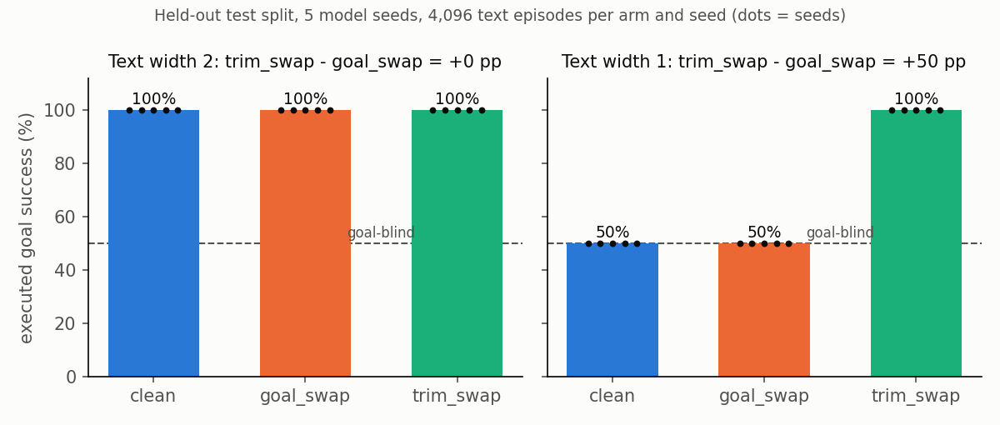
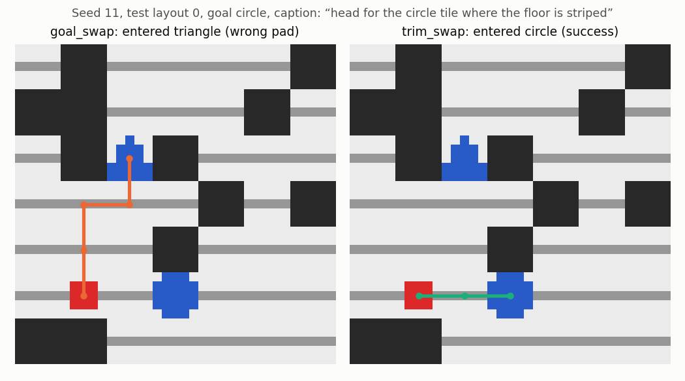

# Platonic Goal Transfer: which corrupted text pair breaks a frozen visual planner?

**Question.** A text encoder learns only from caption-to-caption pairs, and a frozen image-only
planner executes its goals. If 25% of those pairs are rewired, does rewiring the *goal* word hurt
more than rewiring a *cosmetic floor trim* word?

**Outcome.** In the locked main condition (text width 2) all three text arms reached 100% executed
goal success on every held-out episode, so the contrast is +0.00 pp across five seeds. In the
preregistered one-direction capacity stress test (width 1) the goal-corrupted arm fell to 50%
while the trim-corrupted arm stayed at 100%, a +50.00 pp contrast in every seed. Both results
follow from a rank-one effect in the text encoder that the run logs show directly.



## My contribution

Siddharth set the project, the research question and the review requirements, and approved the
locked protocol. GPT-6.2 Astra and Claude Fable 5.2 planned the study. Claude Opus 5.5 authored
the implementation and this report. GPT-6.2 Sol reviewed the code. Codex orchestrated the agents
and independently verified the outputs. Tools: Python 3.12, NumPy 2.4.6, pytest, ruff, and
matplotlib for the two figures.

Code review shaped the evidence before any experiment ran. It caught cross-modal leakage in the
first text pairs, which were image-to-text, and the fix made text training text-only with a
separate set of 128 calibration anchors. It also caught a fractional candidate budget that let
the layout generator retry past its cap. The collected test suite grew from 27 to 47 to 51 across
those phase-1 commits (`25ad075`, `f736b04`, `48af346`) and stands at 86 at the frozen commit
`a3fe519`.

## Evidence at a glance

Takeaway: the planner works whenever the text goal separates the two glyphs, and only the width-1
goal-corrupted encoder loses that separation.

All rows come from the frozen commit `a3fe519`. Test rows are the held-out split (512 layouts in
256 topology clusters). Validation rows are the seed-11 pilots that unlocked the test split.

| Split | Width | Seeds | Text episodes per arm | clean | goal_swap | trim_swap | trim − goal (pp) | 95% CI (pp) |
|---|---|---|---|---|---|---|---|---|
| test (held-out) | 2 | 5 | 20,480 | 100.0% | 100.0% | 100.0% | +0.00 | [+0.00, +0.00] |
| test (held-out) | 1 | 5 | 20,480 | 50.0% | 50.0% | 100.0% | +50.00 | [+50.00, +50.00] |
| validation pilot | 2 | 1 | 4,096 | 100.0% | 100.0% | 100.0% | +0.00 | [+0.00, +0.00] |
| validation pilot | 1 | 1 | 4,096 | 50.0% | 50.0% | 100.0% | +50.00 | [+50.00, +50.00] |

- **Denominators.** Each seed runs 4,096 episodes per text arm: 512 layouts × 2 goals × 2 trims ×
  2 held-out templates. A full held-out run logs 358,400 episodes (71,680 per seed).
- **Per-seed effects.** Width 2 gives 0.0 pp in all five seeds (11, 23, 47, 71, 101). Width 1
  gives +50.0 pp in all five.
- **Uncertainty.** The interval resamples the 256 topology clusters (2,000 draws) with the seed
  pairing fixed. It has zero width because every cluster in every seed shows the same counts
  (width 1: goal_swap 8 of 16, trim_swap 16 of 16).
- **Divergence.** At width 1, 10,240 of 20,480 paired held-out text episodes differ between
  goal_swap and trim_swap. At width 2, none of 20,480 differ.
- **Health (held-out, every seed).** All five gates passed in both runs. The learned one-step
  predictor scored error 0.0 against 1.0 for persistence on 3,931 action-relevant transitions.
- **Controls (held-out, every seed).** Oracle 100%, image goal 100%, glyph-keyword lookup 100%,
  goal-blind 50% (one vector for both twins, so 50% is the ceiling by construction).
  Shuffled calibration averages 37.5% at width 2 (per permutation 100, 0, 50, 0%) and 50% at
  width 1. Timeouts are 0 in every condition.
- **Retrieval (image→text).** Width 2: 100% for all arms. Width 1: trim_swap 100%, clean and
  goal_swap 0%, because their two glyph captions land on the same point and equal-score ties
  count as misses.

The CSV in the evidence folder reproduces every effect, per-seed value and interval above
([paired_counts.csv](evidence/paired_counts.csv), [final-d2 metrics](evidence/runs/final-d2/metrics.json),
[final-d1 metrics](evidence/runs/final-d1/metrics.json)).

## Architecture

Takeaway: the text encoder is the only component that differs between arms, and one small paired
calibration set is the only image-text supervision.

1. **World.** A deterministic 7×7 warehouse rendered as a 35×35 RGB raster. Two pads share a
   colour and differ by glyph (circle or triangle). The floor carries a cosmetic trim (striped or
   dotted) that never affects dynamics. The first pad entered ends the episode, and the horizon
   is 12 steps.
2. **Learned vision, shared by every arm.** From random-action walks on training layouts only,
   the model learns an agent detector, the cell offset each action produces, which cells block
   movement, which entered cells end an episode, and a whitened PCA outcome embedding in three
   dimensions. A structured prior is engineered in: the 5 px cell tiling of the raster, a fixed
   3×3 agent mask, the four-neighbour offset vocabulary, 0.5 thresholds and the PCA sizes.
3. **Frozen planner.** A beam over imagined cells scores each predicted first terminal by its
   distance to the goal vector, executes one action in the real simulator, and replans.
4. **Text encoder, one per arm.** Closed-form symmetric CCA on bag-of-words counts, trained on
   16,384 text-to-text pairs. Those pairs repeat 8 distinct training captions that cover 4
   semantic states (glyph × trim). In the swap arms, 25% of blocks rewire the right caption to
   flip one factor.
5. **Calibration.** A centred orthogonal Procrustes map from text to image latents, fitted on
   128 clean image-caption anchors (64 per glyph). This paired supervision is disclosed and is
   identical for every arm.

Implementation lives in the [source package](../src/pgt), and the locked design is in the
[protocol](protocol.md).

## Consequential decision

Takeaway: locking a second, narrower text width before unlocking the test split turned an
expected tie into a mechanistic test.

A training-only eigenvalue check showed the problem early. Twenty-five percent swaps reduce a
binary contrast's cross-view agreement to 0.75 − 0.25 = 0.5. The logged eigenvalues match: the
swapped factor's direction drops from 0.977199 to 0.488599, exactly half, while the other factor
stays at 0.977199. With two retained directions both axes survive, and the orthogonal
calibration removes the basis change, so the protocol predicted equal arms at width 2. The team
therefore locked width 1 as a one-direction capacity stress test, where the encoder must drop the
weaker direction. Both widths were frozen, piloted on validation and only then unlocked on test
([protocol](protocol.md)).

## Progression

Takeaway: each milestone produced a number that the next one had to beat or explain.

| Milestone | Measured result | Source |
|---|---|---|
| Protocol and simulator | 27 tests collected | commit `25ad075` |
| Review fix: text-only pairs plus separate anchors | 47 tests | commit `f736b04` |
| Review fix: integer candidate budget | 51 tests | commit `48af346` |
| Draft planner, full seed-11 validation pilot | 184.4 s total, 169.8 s evaluation | commit `d310764` run log (outside this repo) |
| Revised planner, matched 16-layout smoke evaluation | 5.9 s before, 0.9 s after | orchestrator review measurement (no stored artifact) |
| Frozen pilots, seed 11, full validation | 38.6 s (width 2), 40.5 s (width 1) | [pilot-d2](evidence/runs/pilot-d2/metrics.json), [pilot-d1](evidence/runs/pilot-d1/metrics.json) |
| Frozen five-seed held-out runs | 165.0 s (width 2), 176.5 s (width 1) | [final-d2](evidence/runs/final-d2/metrics.json), [final-d1](evidence/runs/final-d1/metrics.json) |

The speed-up has two sources. Caching lazily rendered frames, memoising episodes per twin by goal
vector and computing text goals once per seed removed repeated work. The revision also changed
terminal scoring, so candidates became predicted-reachable first terminals with a labelled
fallback. The timing rows come from different source
measurements and isolate neither change.

## Guided walkthrough

Takeaway: one deterministic episode shows the whole mechanism in two steps.

The example is the first held-out width-1 episode, in `episodes.jsonl` line order, where the
goal_swap and trim_swap arms disagree. It is seed 11, test layout 0, striped trim, goal circle,
caption *"head for the circle tile where the floor is striped"*.



- **trim_swap** keeps the glyph direction, so its goal vector sits on the circle. The planner
  steps right twice and enters the circle pad (success in 2 steps).
- **goal_swap** keeps only the trim direction, so its glyph separation is 0.0 and the circle and
  triangle captions map to one point. The planner goes up twice, right once and up again into the triangle pad
  (wrong pad in 4 steps).
- **image goal** on the same layout takes the 2-step circle route, which matches trim_swap.
- **clean** at width 1 is byte-identical to goal_swap (encoder digest `f054ced2e230e092`). Its two
  leading eigenvalues tie at 0.977199, so the first retained direction is a numerical tie-break.
  The protocol reports this arm and leaves it uninterpreted.

Every logged step of these four episodes re-executes in the simulator during the check below
([replay.json](evidence/replay.json)).

## Current scope

Takeaway: this is a controlled toy result about pair construction, with no claim beyond it.

- **Theorem scope.** Balestriero & LeCun state the theorem and already sweep pair quality. This
  study fixes the corruption rate and varies which factor the corruption touches. It tests no
  theorem ([arXiv 2610.39302](https://arxiv.org/html/2610.39302v1)).
- **Similar planners.** Li et al. stitch a visual predictor to other modalities and plan in its
  latent space, and Grounded World Model and Keeping JEPA World Models Plannable already reach
  language goals through frozen planning. Language goals, frozen-planner readout and a
  text-to-latent map are prior art here ([Li et al.](https://arxiv.org/html/2608.23720v2),
  [Grounded World Model](https://arxiv.org/abs/2604.11751),
  [Keeping JEPA World Models Plannable](https://arxiv.org/abs/2610.03137)).
- **This contribution.** A matched pairing control: identical caption multisets, identical swap
  indices and one-token edits, with only the corrupted factor changed.
- **Limits.** Eight training captions and four semantic states make the text side a finite
  lookup. Held-out phrasing reuses the factor words and drops 40 unseen tokens, so its latent
  equals the training latent. This shows no natural-language transfer and no real-world physics.
  The nets are tiny, the world is a 7×7 grid, and the width-2 null is predicted by construction.
  No state-of-the-art claim is made, and nothing is published or deployed.

## Source evidence

Takeaway: every number above traces to a committed file and a one-line check.

- [docs/evidence/runs/](evidence/runs) holds `metrics.json` and `manifest.json` for `pilot-d2`,
  `pilot-d1`, `final-d2` and `final-d1`. The manifests carry source digest
  `db8496dc5870cdfdf587b1395a26f865debd6a234cd66fc5e1723dc7e198e62b` and frozen digests
  `8d3cb76f8914fa32dea36c57e5ade5c4fddc50474b051508aae3caf638881607` (width 2) and
  `a30bf19488bb6327faef444273c24518682692b96cb76b987647a6f571b485c2` (width 1).
  Their recorded commands already used relative paths, so sanitising changed no parameter.
- [docs/evidence/paired_counts.csv](evidence/paired_counts.csv) has 9,216 rows, one per split,
  width, seed, topology cluster and text arm, with episodes, successes, wrong pads and timeouts.
- [docs/evidence/replay.json](evidence/replay.json) and the two PNGs derive from the actual
  records. The 860,160 raw episode lines stay out of Git.
- [scripts/build_evidence.py](../scripts/build_evidence.py) rebuilds and checks all of it.

Reproduce the frozen runs from the repo root, then rebuild and check the evidence:

```sh
python -m pgt.experiment run --split validation --seeds 11 --text-dim 2 --max-minutes 20 --out runs/frozen/pilot-d2
python -m pgt.experiment run --split validation --seeds 11 --text-dim 1 --max-minutes 20 --out runs/frozen/pilot-d1
python -m pgt.experiment run --split test --seeds 11 23 47 71 101 --text-dim 2 --max-minutes 20 --out runs/frozen/final-d2 --unlock-test --pilot runs/frozen/pilot-d2/metrics.json
python -m pgt.experiment run --split test --seeds 11 23 47 71 101 --text-dim 1 --max-minutes 20 --out runs/frozen/final-d1 --unlock-test --pilot runs/frozen/pilot-d1/metrics.json
python scripts/build_evidence.py build --runs runs/frozen   # checks raw logs, writes docs/evidence
python scripts/build_evidence.py check                      # committed files only
python scripts/build_evidence.py figures                    # needs matplotlib
```
